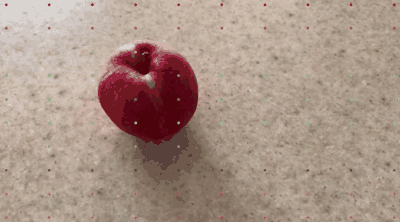
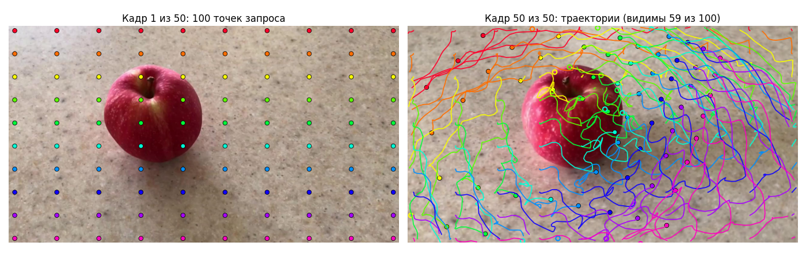
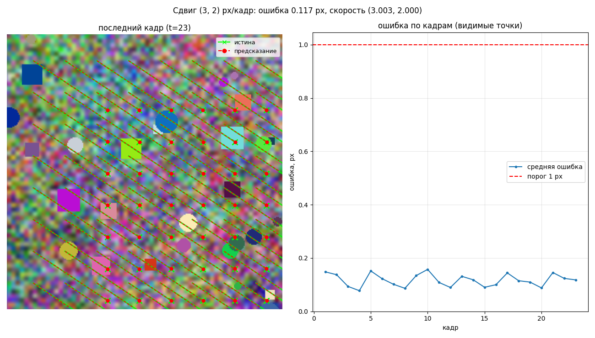
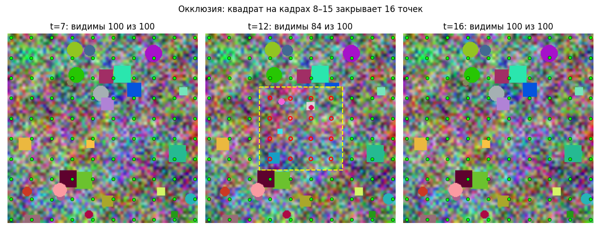
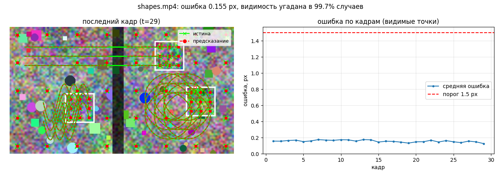

# CoTracker3 в Docker: трекинг точек на видео

Лабораторная работа по курсу «Разработка систем глубокого обучения»: запуск и тесты
нейросети **CoTracker3** упакованы в Docker так, чтобы их можно было проверить одной
командой на обычном компьютере без GPU, а результаты (видео, GIF, картинки) появились
в папке `./results`.

**CoTracker3** (Meta AI и Oxford VGG) — трансформер, который отслеживает произвольные
точки на видео: для каждой точки, заданной на одном кадре, он предсказывает её
координаты на всех кадрах и то, видна ли она (или закрыта другим объектом, или ушла
из кадра). Точки отслеживаются совместно, поэтому модель держит трек и при окклюзиях.

- статья: [CoTracker3: Simpler and Better Point Tracking by Pseudo-Labelling Real Videos](https://arxiv.org/abs/2410.11831)
- код авторов: [facebookresearch/co-tracker](https://github.com/facebookresearch/co-tracker), исходный README — в [README_ORIGINAL.md](README_ORIGINAL.md)
- веса: [facebook/cotracker3](https://huggingface.co/facebook/cotracker3), используется `scaled_offline.pth`



## Быстрый старт

Нужен только Docker (Docker Desktop на Windows/macOS или Docker Engine на Linux).

```bash
git clone https://github.com/IronDiaper/co-tracker.git
cd co-tracker
bash run.sh
```

На Windows то же самое в PowerShell:

```powershell
git clone https://github.com/IronDiaper/co-tracker.git
cd co-tracker
.\run.ps1
```

Первый запуск собирает образ (около 2 минут, нужен интернет), затем запускает 13 тестов
без сети (около 1.5–2 минут на 4 ядрах): весь путь от клона до результата занимает
около 3.5 минут. В конце печатается таблица с метриками и
`TESTS DONE!`, а все видео и картинки лежат в `./results/tests/`. Повторный запуск
пропускает сборку. Требования, замеры и решение проблем — в [TESTING.md](TESTING.md).

### Своё видео

Видео можно взять из любой папки: укажите путь к нему после `--demo`. Образ тот же,
что и для тестов, отдельно ничего собирать не нужно. Видео подключается в контейнер
только для чтения, сеть по-прежнему отключена.

```bash
bash run.sh --demo ~/Videos/my_video.mp4
```

```powershell
.\run.ps1 --demo "C:\Users\me\Videos\my_video.mp4"
```

Результат появится в `results/demo/my_video/`:

| Файл | Что внутри |
|---|---|
| `tracks.mp4` | видео с нарисованными треками |
| `preview.gif` | уменьшенное GIF-превью |
| `summary.png` | первый кадр с точками и последний кадр с траекториями |
| `tracks.npy`, `visibility.npy` | координаты точек `[T, N, 2]` и их видимость `[T, N]` |
| `summary.json` | число точек и кадров, доля видимых точек, время инференса |

Параметры демо пишутся после `--` (в PowerShell `--` можно не писать):

```bash
bash run.sh --demo ~/Videos/my_video.mp4 -- --grid_size 15 --max_frames 60 --resize 480
```

- `--grid_size` — сетка G×G точек на первом кадре (по умолчанию 10);
- `--max_frames` — взять только первые N кадров. Модель обрабатывает ролик целиком за
  один проход, поэтому время и память растут с числом кадров: 50 кадров 720p — около
  20 секунд и 2.3 ГБ памяти на 4 ядрах. Длинные ролики лучше ограничивать 60–100 кадрами;
- `--resize` — высота кадра в пикселях: уменьшает файлы результатов, на скорость почти
  не влияет.

Проверены форматы mp4, mov, avi, mkv и webm, в том числе пути с пробелами (путь
тогда нужно взять в кавычки).

## Что происходит при запуске

```
bash run.sh
 ├─ [1/3] сборка образа cotracker3:test, если его ещё нет
 │        weights: скачать scaled_offline.pth, проверить sha256
 │        base:    python 3.10 + PyTorch 2.4.1 (CPU) + зависимости + пакет cotracker
 │        test:    + веса, скрипты, тестовые видео, pytest
 ├─ [2/3] docker run --network none ... pytest   (13 тестов, результаты -> ./results)
 └─ [3/3] список созданных файлов, время, TESTS DONE!
```

Модель загружается из локального пакета `cotracker` и чекпоинта внутри образа, без
`torch.hub`, поэтому тесты работают с отключённой сетью (`--network none`).

## Что проверяют тесты

| Тест | Что проверяет | Результат на CPU |
|---|---|---|
| `test_model_load.py` | веса читаются из локального файла (sha256), сеть и `torch.hub` заблокированы | 188 тензоров совпадают с файлом |
| `test_outputs.py` | формы `tracks [B,T,N,2]`, `visibility [B,T,N]`, конечные значения, видимые точки в кадре | OK |
| `test_static_video` | один кадр, повторённый 24 раза: точки не должны смещаться | максимум 0.195 px (порог 1 px) |
| `test_shift_accuracy` | текстура сдвигается на известные (dx, dy) за кадр — главный количественный тест | ошибка 0.09–0.12 px (порог 1 px) |
| `test_occlusion` | квадрат закрывает часть кадра: закрытые точки становятся невидимыми и находятся снова | 100% закрытых точек скрыты |
| `test_demo_on_real_video` | полный пайплайн на `apple.mp4`: mp4, GIF, PNG, npy, json; кадров в mp4 столько же, сколько во входе | 50 = 50 |
| `test_procedural_video_accuracy` | сжатые H.264 ролики с известными треками | ошибка 0.16–0.21 px (порог 1.5 px) |
| `test_matches_reference` | треки `apple.mp4` совпадают с эталоном из `reference/` | порог 0.5 px |
| `test_author_bilinear_sampler` | исходный юнит-тест авторов | OK |

## Примеры результатов

Слева сетка точек на первом кадре, справа траектории за всё видео
(`results/tests/e2e_apple/summary.png`):



Синтетический сдвиг на (3, 2) px за кадр: истинные траектории (зелёные) и предсказанные
(красные), справа ошибка по кадрам (`results/tests/shift_dx3_dy2.png`):



Окклюзия: точки под квадратом модель помечает невидимыми (красные контуры), после
исчезновения квадрата находит их снова (`results/tests/occlusion.png`):



Процедурный ролик `shapes.mp4`: трек спрайта обрывается, пока он за тёмным столбом
(`results/tests/e2e_shapes/gt_vs_pred.png`):



## Флаги

| `run.sh` / `run.ps1` | Что делает |
|---|---|
| *(без флагов)* | собрать образ, если его нет, и запустить все тесты |
| `--demo <видео>` | демо на своём видео: результаты в `results/demo/<имя>/` |
| `--rebuild` | пересобрать образ (после изменения кода или зависимостей) |
| `--gpu` | собрать и запустить GPU-образ (`cotracker3-gpu:test`, `--gpus all`) |
| `--make-reference` | пересоздать эталон `reference/` |
| `-- <аргументы>` | передать аргументы pytest (или `run_demo.py` вместе с `--demo`) |

Примеры:

```bash
bash run.sh --demo ~/Videos/dog.mp4 -- --grid_size 15 --max_frames 60 --resize 480
bash run.sh -- -k shift          # только тесты сдвига
bash run.sh --gpu                # то же на видеокарте NVIDIA
```

В PowerShell флаги те же: `.\run.ps1 --demo C:\video.mp4 --grid_size 15`
(разделитель `--` в PowerShell можно не писать).

Параметры `scripts/run_demo.py`:

| Параметр | По умолчанию | Что задаёт |
|---|---|---|
| `--video` | `assets/apple.mp4` | входное видео |
| `--grid_size` | 10 | сетка G×G точек на первом кадре |
| `--max_frames` | 0 (все) | взять только первые N кадров |
| `--resize` | 0 (без изменения) | высота кадра в пикселях, ширина по пропорции |
| `--trace` | 15 | длина «хвоста» трека в mp4 и GIF, кадров |
| `--device` | `auto` | `cpu`, `cuda` или автовыбор |
| `--fmaps_chunk` | 8 | кадров за проход энкодера признаков (меньше — меньше памяти) |

Результат демо: `tracks.mp4` (видео с треками), `preview.gif`, `summary.png`
(первый кадр с точками | последний кадр с траекториями), `tracks.npy` `[T, N, 2]`,
`visibility.npy` `[T, N]`, `summary.json` (число точек и кадров, доля видимых точек,
время инференса, пиковая память).

## Структура

```
co-tracker/
├── run.sh, run.ps1          точки входа (bash и PowerShell)
├── Dockerfile               стадии: weights → base → app → test / runtime
├── requirements.txt         CPU: torch 2.4.1+cpu
├── requirements-gpu.txt     GPU: torch 2.4.1+cu121
├── requirements-common.txt  общие зависимости, все версии зафиксированы
├── requirements-test.txt    pytest
├── pytest.ini
├── scripts/
│   ├── run_demo.py          видео → треки → mp4 / gif / png / npy / json
│   ├── download_weights.py  скачивание весов при сборке с проверкой sha256
│   └── make_reference.py    создание эталона reference/
├── tests/
│   ├── test_*.py            тесты (13 штук вместе с параметризацией)
│   ├── test_bilinear_sample.py  тест авторов, не изменён
│   ├── conftest.py          общая модель на сессию, итоговая таблица
│   ├── helpers.py           вызов модели и картинки
│   ├── synthetic.py         генератор синтетических видео с истинными треками
│   └── data/                apple.mp4, shapes.mp4, pan_zoom.mp4 и их треки
├── reference/               эталонные треки apple.mp4 (см. reference/README.md)
├── checkpoints/             пустая; сюда можно положить веса вручную
├── media/                   картинки для этого README
├── results/                 создаётся при запуске, в git не попадает
├── cotracker/, demo.py, ... код авторов без изменений
└── README_ORIGINAL.md       исходный README авторов
```

После запуска тестов:

```
results/tests/
├── e2e_apple/        tracks.mp4, preview.gif, summary.png, tracks.npy, visibility.npy, summary.json
├── e2e_shapes/       tracks.mp4, preview.gif, gt_vs_pred.png
├── e2e_pan_zoom/     tracks.mp4, preview.gif, gt_vs_pred.png
├── shift_dx3_dy2.png, shift_dx-2_dy4.png, static_video.png, occlusion.png
├── outputs_grid.png, reference_compare.png
├── model_info.json, author_test_bilinear_sample.log
└── report.json       все метрики и статусы тестов
```

## Пересборка и изменения

- Изменили код в `scripts/`, `tests/` или `cotracker/` — `bash run.sh --rebuild`.
- Полная пересборка без кэша Docker:
  `docker build --no-cache --target test -t cotracker3:test .`
- Обновили версии библиотек — пересоздайте эталон: `bash run.sh --make-reference`.
- Свой чекпоинт или нет доступа к Hugging Face — положите `scaled_offline.pth` в
  `checkpoints/` (см. [checkpoints/README.md](checkpoints/README.md)) и пересоберите.

Образ без pytest для одного демо: `docker build --target runtime -t cotracker3:runtime .`,
затем `docker run --rm --network none -v "$(pwd)/results:/app/results" cotracker3:runtime`.

## Что изменено относительно репозитория авторов

Код авторов (`cotracker/`, `demo.py`, `tests/test_bilinear_sample.py` и т.д.) не менялся.
Добавлены Docker-обвязка, скрипты, тесты и данные; исходный `README.md` переименован в
`README_ORIGINAL.md`. Особенности кода авторов, которые пришлось обойти снаружи:

- `Visualizer.save_video` теряет 3 кадра и дублирует первый — mp4 пишется своим кодом;
- `CoTrackerPredictor` не передаёт модели `fmaps_chunk_size`, и признаки всех кадров
  считаются разом — параметр подставляется через `functools.partial`, пиковая память
  на `apple.mp4` падает с 5.4 до 2.3 ГБ при побитово одинаковых треках;
- `cm.get_cmap` в Visualizer удалён в matplotlib 3.9 — зафиксирован matplotlib 3.8.4;
- `tests/test_bilinear_sample.py` вызывает `unittest.main()` при импорте — запускается
  отдельным процессом.
